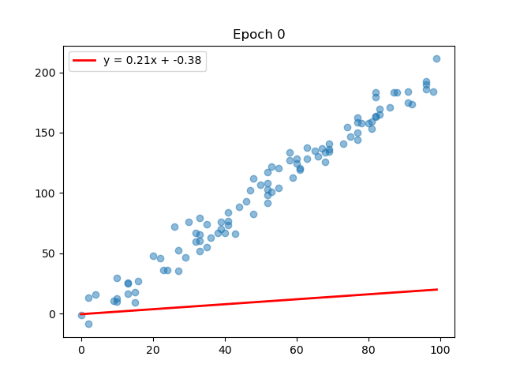
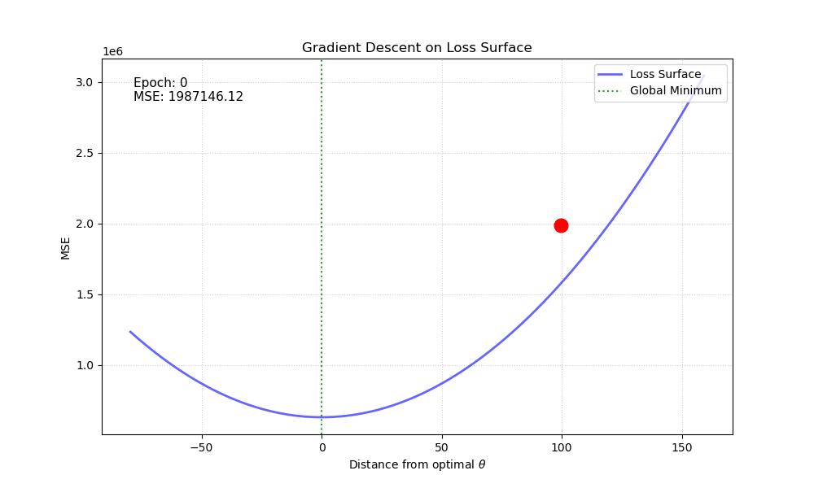
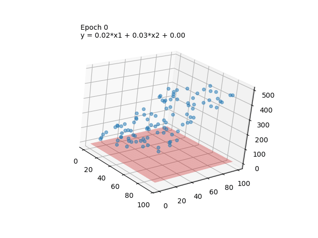
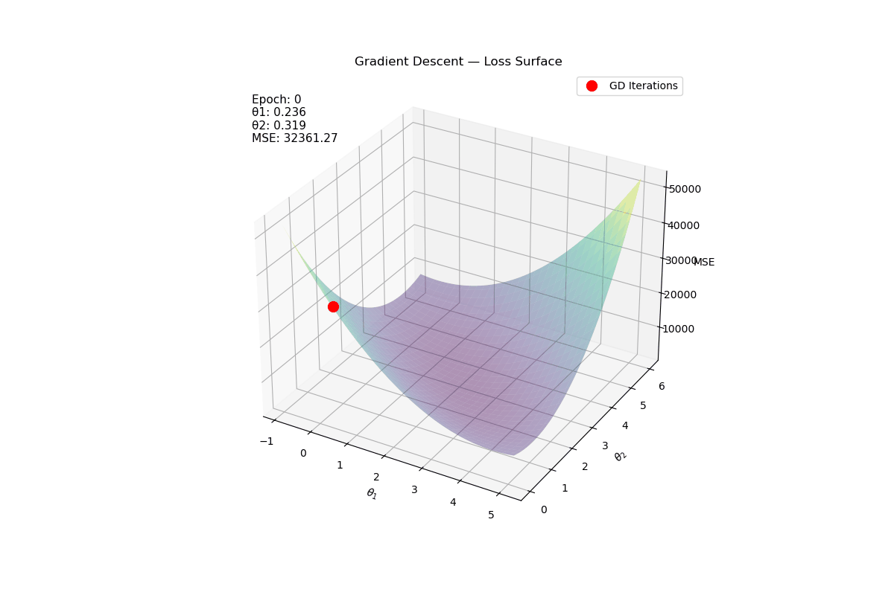

# Linear Regression from Scratch


Implementation of linear regression from scratch using two methods: 
- Normal Equation
- Gradient Descent
with training process visualization.

## Demo
| 2D Gradient Descent | Loss Surface 2D |
|---------------------|-----------------|
|  |  |

| 3D Gradient Descent | Loss Surface 3D |
|---------------------|-----------------|
|  |  |

> Click on any gif to view the full animation.

## Math Background

### Normal Equation
An analytical solution to the MSE minimization problem, derived by setting 
the gradient to zero:

$$\theta = (X^TX)^{-1}X^Ty$$

There is a possible problem: $(X^TX)^{-1}$ can be [singular matrix](https://en.wikipedia.org/wiki/Singular_matrix).
I deal with this problem using [pseudoinverse matrix](https://en.wikipedia.org/wiki/Moore%E2%80%93Penrose_inverse).
You can read more about the proof [here](https://eli.thegreenplace.net/2014/derivation-of-the-normal-equation-for-linear-regression) and [here](https://eli.thegreenplace.net/2015/the-normal-equation-and-matrix-calculus/).
### Gradient Descent

An iterative optimization of the loss function:

$$\theta := \theta - \alpha \cdot \nabla J(\theta)$$

The implementation minimizes half the mean squared error,

$$J(\theta) = \frac{1}{2m} \lVert X\theta-y \rVert_2^2,$$

whose gradient is:

$$\nabla J(\theta) = \frac{1}{m} X^T(X\theta - y)$$

### Implementation note

In the code I use `add_bias_column` to construct the design matrix with an explicit intercept term (bias) prepended as a column of ones. Note that some implementations and literature keep the intercept separate from the feature matrix and treat it as a standalone parameter.

### Computational cost

Let **m** be the number of observations, **p** the number of coefficients
(including the intercept), and **k** the number of gradient descent iterations.
For a dense design matrix X with shape m × p:

| | Normal Equation | Full-batch Gradient Descent |
|---|---|---|
| Training time | $O(mp^2 + p^3)$ | $O(kmp)$ |
| Main operations | Form $X^TX$: $O(mp^2)$; compute its pseudoinverse: $O(p^3)$; remaining products: $O(mp^2)$ in this implementation | Matrix-vector products per iteration: $O(mp)$ |
| Learning rate | Not required | Required; affects convergence |
| Result | Direct least-squares solution, subject to floating-point precision | Iterative approximation; stops on small loss change or the epoch limit |
| Numerical considerations | Pseudoinverse handles rank deficiency, but forming $X^TX$ worsens conditioning | Standardization helps; stability depends on the learning rate and conditioning |

The code uses `pinv(X.T @ X) @ X.T @ y`, not just a matrix inversion.
Its multiplication order also creates a p × m intermediate. Gradient descent
standardizes X once in $O(mp)$ and stores coefficient history for the animations,
using $O(kp)$ space for that history. Including prepared matrices, additional
storage is $O(mp+p^2)$ for the direct method and $O(mp+kp)$ for this gradient
descent implementation.

Many observations with few features can still favor a direct solve. Many features
make the p × p Gram matrix expensive; gradient descent trades that cost for
repeated passes over the data. There is no universal 10,000-feature cutoff.
For better numerical conditioning, an SVD/QR least-squares solve on X avoids
explicitly forming the Gram matrix; that is not the method implemented here.

### Metrics
- **MSE** — loss function
- **$R^2$** — proportion of explained variance
- **t-statistics / p-values** — coefficient significance

## Project Structure

```
linear-regression-from-scratch/
├── src/
│   ├── strategies/
│   │   ├── base.py           # abstract Strategy class
│   │   ├── normal_equation.py
│   │   └── gradient_descent.py
│   ├── main.py               # main file for tests
│   ├── model.py              # LinearRegression + Factory Method
│   ├── metrics.py            # MSE, R², t-test, p-values
│   └── utils.py
├── showcase/
│   ├── 2d/                   # plots for 1 predictor
│   └── 3d/                   # plots for 2 predictors
├── tests/
│   ├── test_normal_equation.py
│   └── test_gradient_descent.py
├── assets/                   # saved plots and gifs
└── requirements.txt
```

## Tech Stack
- Python 3.10+
- NumPy — mathematical operations
- Matplotlib — visualization
- SciPy — only used for p-values
- Pytest — testing
- GitHub Actions - CI/CD

## Installation

```bash
git clone https://github.com/G10BAL/linear-regression-from-scratch.git
cd linear-regression-from-scratch
python3 -m venv venv
source venv/bin/activate
pip install -r requirements.txt
```

## Quick Start

The simplest way to try it out — run `src/main.py`, 
modifying the data to your needs:

```python
model = LinearRegression(method="normal")  # or "gradient_descent"
model.fit(X, y)
print(model.theta)
```

```bash
python3 -m src.main
```

## Showcase

For a deeper understanding of how the algorithms work, it is recommended 
to run the showcase files yourself — especially the 3D plots, 
which can be rotated interactively in matplotlib:

```bash
# 2D
python3 -m showcase.2d.2d_graph
python3 -m showcase.2d.gradient_by_frames_2d
python3 -m showcase.2d.loss_function_ani_2d

# 3D — recommended for interactive exploration
python3 -m showcase.3d.3d_graph
python3 -m showcase.3d.gradient_by_frames_3d
python3 -m showcase.3d.loss_function_ani_3d
```

## Tests

```bash
python3 -m pytest tests/ -v
```

Tests verify the mathematical correctness of both methods — accuracy of 
coefficient recovery, theta shape, and gradient descent convergence.

## Sources
- [Proof of the normal equation](https://eli.thegreenplace.net/2014/derivation-of-the-normal-equation-for-linear-regression)
- [Calculus of matrices](https://eli.thegreenplace.net/2015/the-normal-equation-and-matrix-calculus/)
- [Gradient descent breakdown](https://www.geeksforgeeks.org/machine-learning/gradient-descent-in-linear-regression/)

